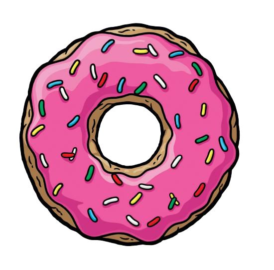

  

<h1 align="center">Donut em varias linguagens</h1> 

É apenas um donut desenhado em varias linguagens diferentes

Tabela de conteúdos
=================
<!--ts-->
   * [Sobre](#Sobre)
   * [Como funciona](#Como-funciona)
   * [Fotos](#Fotos)
   * [Tabela de Conteudo](#tabela-de-conteudo)
   * [Instalação](#instalacao)
   * [Como usar](#como-usar)
      * [Pre Requisitos](#pre-requisitos)
   * [Tecnologias](#tecnologias)
<!--te-->

<h4 align="center"> 
	🚧  Em desenvolvimento.  🚧
</h4>

## Sobre

Em desenvolvimento

## Como funciona

Em seu núcleo, é um framebuffer e um Z-buffer no qual se renderiza pixels. 
Uma vez que está apenas renderizando arte ASCII de resolução relativamente baixa, eu trapaceio maciçamente. 
Tudo o que ele faz é plotar pixels ao longo da superfície do toro em incrementos de ângulo fixo, e o faz com densidade suficiente para que o resultado final pareça sólido. 
Os “pixels” que plota são caracteres ASCII correspondentes ao valor de iluminação da superfície em cada ponto:., - ~:; =! * # $ @ 
Do mais escuro ao mais brilhante. 

## Fotos

Em desenvolvimento

## Tabela de conteudo

- [x] C
- [ ] C++
- [ ] Dart
- [ ] JavaScript
- [ ] Python

## Instalacao

Para instalar esse repositorio basta seguir os seguintes passos

1) Digite em seu terminal 

   <code>git clone https://github.com/Taunt-byte/Desafio-Donut.git</code>

## Como usar

- Em desenvolvimento

## Pre requisitos

Para se ter proveito desse repositorio basta ter em sua maquina os seguintes itens: 
 
1) Instale o Git em sua maquina

2) Instale uma IDE (Recomendo o VScode)  

## Tecnologias

 <table>
    <tr>
    <td>C</td>
    <td>C++</td>
    </tr>
    <tr>
    <td>-</td>
    <td>-</td>
    </tr>
</table>